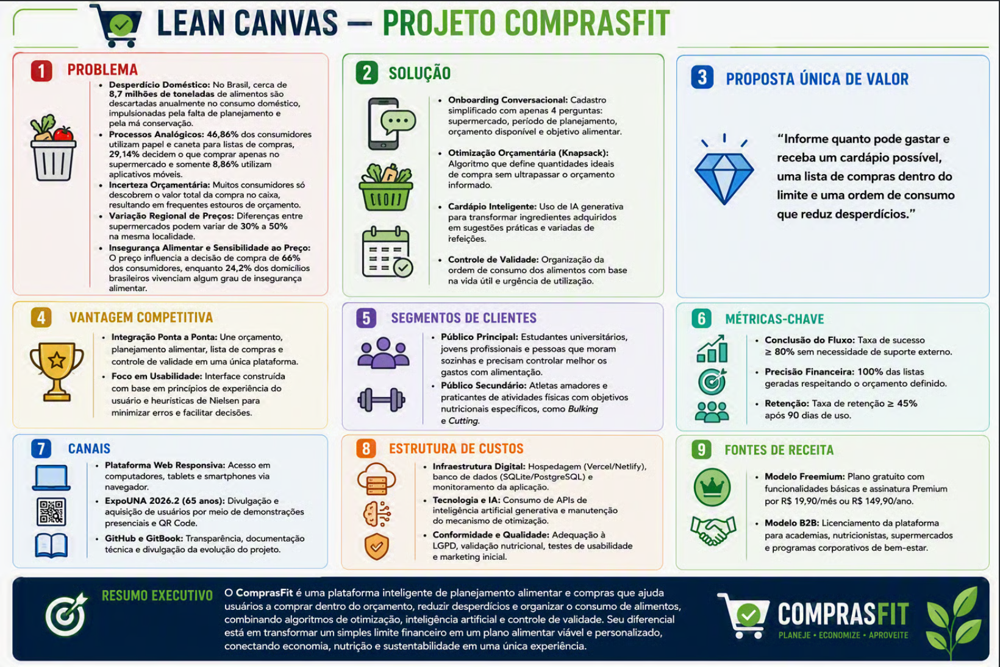

# CANVAS

O **Lean Canvas do ComprasFit** apresenta de forma visual e estratégica o modelo de negócio do projeto, destacando os principais problemas dos consumidores, as soluções propostas, a proposta de valor, o público-alvo e os diferenciais competitivos. O canvas também reúne as métricas de sucesso, os canais de divulgação, a estrutura de custos e as fontes de receita, oferecendo uma visão geral de como o ComprasFit busca otimizar as compras, controlar o orçamento e reduzir o desperdício de alimentos.

<figure><figcaption></figcaption></figure>
